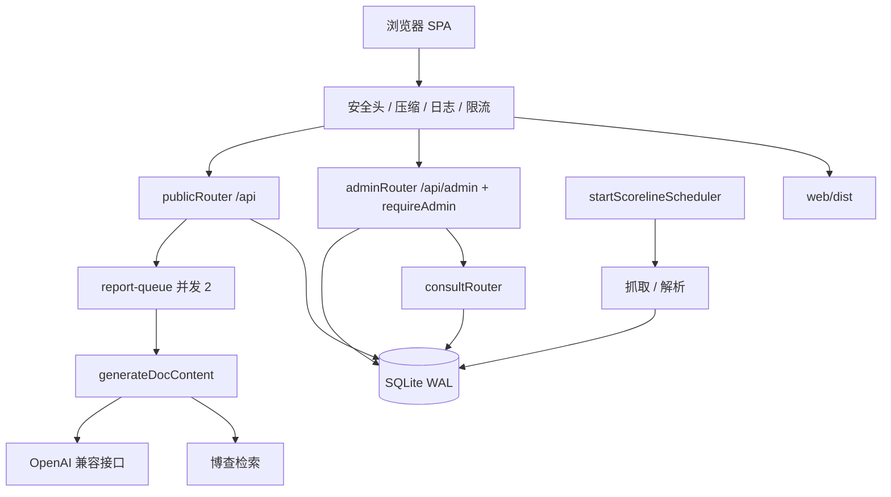

# 02 — 架构

> 维护者：Doc Agent ｜ 状态：L2（2026-11-26 初始化） ｜ 最近更新：2026-11-26
> 本文件是工作流视角的架构索引；产品细节以代码与 `LosAngelousDocs/03-design.md` 为准（原 `docs/` 已移出，备份可查）。

## 系统上下文

一个 Node 进程、一个 SQLite 文件、一个前端静态目录。没有独立消息队列、缓存服务或数据库服务。

## 模块表

| 模块 | 路径 | 职责 | 不负责 | 依赖 |
|---|---|---|---|---|
| 装配层 | `server/src/index.ts` | 中间件、路由挂载、静态站点、启动任务 | 业务规则 | Express |
| 公开路由 | `server/src/routes/public.ts` | 邀请、提交、报告轮询 / 重试 / 领取、events、health | 后台鉴权 | shared、db、ai 队列 |
| 管理路由 | `server/src/routes/admin/*` | 登录、概览、邀请、名单、答卷、设置、分数线、知识库 | 报告正文生成 | `requireAdmin()` |
| 咨询路由 | `server/src/routes/consult/*` | 工作台、目的树、咨询树、收藏、金句、故事、提问、话题、运行与导出 | 问卷评分 | shared、consult-modules |
| AI | `server/src/ai/*` | 队列、模型调用、检索、审计、清洗 | 产品文案口径 | LLM、博查、db |
| 分数线 | `server/src/score-lines/*` | 种子、调度、抓取、解析、覆盖度、查询 | 人工判分 | cheerio / xlsx / pdfjs |
| 领域层 | `shared/src/*` | 问卷、跳题、评分、报告、日期、分数线维度（纯函数） | DB / env | 无 |
| 前端 | `web/src/*` | 公开页、后台页、API 客户端、组件 | 复制后端规则 | Vue 3、Vite |
| 守卫 | `scripts/check-*.mjs` | 文档 / 规模 / 版本 / 依赖一致性 | 业务逻辑 | Node |
| 部署 | `update.sh`、`deploy/` | L1–L5、systemd / Nginx / 备份 | 业务逻辑 | GitHub Release |

## 关键数据流

1. **问卷 → 报告**：`POST /api/invite/:token/submit` 校验并计分 → 事务写 `submissions` → `enqueueReport` → AI 生成 → 审计 / 清洗 → 落库 → `/r/:slug` 轮询。事务边界在提交落库；AI 是异步的，失败可重试。
2. **咨询稿**：`POST /api/admin/consult/runs` 创建运行 → 后台任务生成 → 章节 `PATCH` / `beats` / `regenerate` → `GET .../export/:format` 导出 `docx|html|txt`。
3. **分数线**：调度器一次一省 → 按 `Content-Type` 分派 8 个解析器 → 写批次 / 指标 / 来源文档 → 按 `confidence` 自动 `approved / rejected`（≥0.70 可查）；v2.07 校级录取表先 upsert `school_programs` 再写 `scope='program'` 批次。

失败点：AI 未配置 / 规则为空 / 4 次机会用尽 / JSON 不可解析；抓取网络错误与解析失败；提交校验失败。详见 `LosAngelousDocs/03-design.md`（原 `docs/README.md` 已移出，备份可查）。

## 外部依赖

| 依赖 | 用途 | 失败模式 | 超时/重试 |
|---|---|---|---|
| OpenAI 兼容接口 | AI 报告 / 咨询稿正文 | 超时、限流、JSON 不可解析 | `AI_TIMEOUT_MS` 默认 240s；最多 4 次尝试 |
| 博查 Web Search | 报告岗位证据 | 网络错误 / 无权限 / 参数错误 | 瞬时错误退避重试一次；结果缓存 7 天；单报告最多 4 次外呼 |
| 各省考试院 / 研招网 | 分数线抓取 | 结构差异、PDF 扫描件、站点改版 | 调度器串行；失败记失败码，人工导入兜底 |
| GitHub Release `dist` | 前端产物 | 404 / 网络 / SHA 不匹配 | `update.sh` 失败保留上一版且不重启 |

## 技术选型

- Node 24 + `node:sqlite`：内置 SQLite、WAL，无需独立数据库服务（代码现状）。
- Express + tsx：现有约定，类型检查通过 `tsc --noEmit`。
- Vue 3 + Vite：后台与公开页共用一套 SPA；前端产物由 CI 构建，服务器只下载替换。
- 单进程内存队列：按单实例部署设计；重启时扫描数据库 `pending/running` 续跑。
