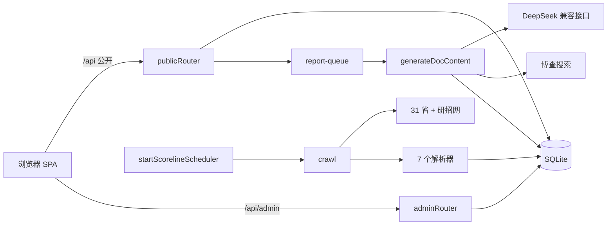

> 维护者：Doc Agent ｜ 最近更新：2026-11-26 ｜ 状态：草稿（定点勘误，待用户复核）

# 项目概述

## 1. 定位

Vesta 是一套**邀请制的“大学现状自评”系统**：运营者给学员发一次性链接，学员填完 28 题问卷后得到一份个性化报告；运营者在后台看名单、改报告、写咨询稿，并用分数线库支撑判断。

它同时承担四件事：

1. **问卷与报告**：公开填写、提交即入队、AI 生成全文报告、失败可重试。
2. **咨询稿工作台**：按目的树 / 逐句路径选模块，生成可编辑、可导出的咨询稿。
3. **分数线数据台**：31 省专升本来源 + 研招网来源的抓取、解析、人工复核、覆盖度统计。
4. **运营后台**：邀请链接、学员名单、答卷详情、问卷 / 模板 / AI 规则配置、CSV 导出。

证据：`docs/reference/README.md#版本约定` 与 `web/src/router.ts` 的路由表（`/i/:token`、`/r/:slug`、`/admin/*`）。

## 2. 形态

| 维度 | 结论 | 证据 |
| --- | --- | --- |
| 交付形态 | Web 服务 + SPA + 管理后台 + 定时抓取任务 + CLI 维护脚本 | `package.json#scripts`、`server/src/index.ts`、`scripts/` |
| 仓库形态 | npm workspaces 单仓多包：`server`、`web`，共享代码在 `shared/src` | `package.json#workspaces` |
| 进程形态 | 一个 Node 进程同时提供 `/api`、`/api/admin` 与 `web/dist` 静态站点 | `server/src/index.ts`、`package.json#scripts.start` |
| 部署形态 | `update.sh` 支持 `systemd` / `pm2` / `docker` / `none` / `auto` | `update.sh` 的 `--mode` 选项 |
| 数据形态 | 单文件 SQLite（`node:sqlite`，WAL） | `server/src/db/connection.ts`、`server/src/env.ts#config` |

## 3. 技术栈

| 层 | 技术 | 版本/约束 | 证据 |
| --- | --- | --- | --- |
| 运行时 | Node.js | `>=24.0.0`，`.node-version` 为 24 | `package.json#engines` |
| 后端框架 | Express | `^4.21.2` | `server/package.json#dependencies` |
| 后端语言 | TypeScript + `tsx` | TS `^5.7.3`，`tsx` `^4.19.2` | `server/package.json` |
| 数据库 | `node:sqlite` | Node 内置，WAL | `server/src/db/connection.ts` |
| 前端 | Vue 3 + Vue Router 4 | Vue `^3.5.13`，Router `^4.5.0` | `web/package.json` |
| 构建 | Vite | `^6.0.7` | `web/package.json` |
| 报告导出 | `html-to-image` + `jspdf` | `^1.11.13` / `^4.2.1` | `web/package.json` |
| 文档解析 | `cheerio`、`pdfjs-dist`、`xlsx` | `^1.2.0` / `^6.5.438` / `^0.18.5` | `server/package.json` |
| 压缩 | `compression` | `~1.7.4` | `server/package.json` |
| AI | OpenAI 兼容的 Chat Completions | 模型名由 `AI_MODEL` 指定，仓库默认 `deepseek-chat` | `server/src/ai/deepseek.ts`、`.env.example` |
| 搜索 | Bocha Web Search API | 可关闭；未配置时报告不搜网 | `server/src/ai/bocha.ts`、`server/src/ai/generate.ts#isSearchConfigured` |

## 4. 运行时架构（一图流）

图中符号均可在源码找到：`publicRouter`（`server/src/routes/public.ts`）、`adminRouter`（`server/src/routes/admin/index.ts`）、`report-queue` 的 `enqueueReport` / `startReportQueue`、`generateDocContent`（`server/src/ai/doc-generate.ts`）、`startScorelineScheduler`（`server/src/score-lines/crawl-scheduler.ts`）。

关键点：

- **AI 只在写文案**：分数、优先级、截止时间、岗位卡等确定性内容由 `shared/src` 计算，AI 失败不会被模板伪装成“已生成”。见 `server/src/ai/doc-generate.ts` 与 `docs/reference/development-history.md` 的 v1.83 轮次。
- **队列在进程内**：FIFO、并发 2、最多 4 次尝试、启动时恢复未完成报告。进程重启会丢失“排队中但未开始”的内存任务，`resumeUnfinishedReports` 只恢复数据库里 `pending` / `running` 且未超次数的记录。
- **抓取串行**：同一时间只跑一个省份的抓取任务；调度器每 10 分钟检查一次到期来源。

## 5. 模块地图

| 区域 | 目录 | 职责 | 入口符号 |
| --- | --- | --- | --- |
| 后端装配 | `server/src/index.ts` | 中间件、路由挂载、静态站点、启动任务 | 进程入口 |
| 公开 API | `server/src/routes/public.ts` | 健康检查、邀请、提交、报告轮询、重试、领取 | `publicRouter` |
| 管理 API | `server/src/routes/admin/*` | 登录、概览、邀请、名单、答卷、设置、分数线 | `adminRouter` |
| 咨询 API | `server/src/routes/consult/*` | 工作台、目的树、收藏栏、生成运行、章节编辑、导出 | `consultRouter` |
| AI 报告 | `server/src/ai/*` | 队列、DeepSeek 调用、搜索、审计、清洗、提示词 | `generateDocContent`、`enqueueReport` |
| 分数线 | `server/src/score-lines/*` | 来源种子、抓取、解析分派、归一化、覆盖度、查询 | `resolveParserId`、`startScorelineScheduler` |
| 领域共享 | `shared/src/*` | 类型、问卷、评分、报告、日期/周期、分数线维度 | `defaultSurvey`、`computeScores`、`buildReport` |
| 前端 | `web/src/*` | 公开页、后台页、API 客户端、组件 | `web/src/router.ts`、`web/src/main.ts` |
| 运维脚本 | `scripts/*`、`deploy/*`、`update.sh` | 文档/大小/版本/依赖守卫、导入、部署资产 | `scripts/check-docs.mjs` |

规模（只读统计，2026-11-16）：

| 目录 | 文件数 | 行数 |
| --- | --- | --- |
| `server/src` | 80 个 `.ts` | 17,852 |
| `web/src` | 95 个 `.ts/.vue` | 22,802 |
| `shared/src` | 24 个 `.ts` | 7,000 |
| `scripts` | 10 个 `.ts/.mjs` | 1,416 |

## 6. 核心流程

### 6.1 邀请 → 答卷 → 报告

1. 管理员 `POST /api/admin/invites` 批量建链接（单次最多 100 个姓名），返回 `token` 与 `path`。
2. 学员打开 `/i/:token`，`GET /api/invite/:token` 返回姓名、备注、问卷、是否已提交。
3. 学员提交 `POST /api/invite/:token/submit`：校验答案 → 计算分数/优先级 → 事务写 `submissions` 并把邀请置为 `submitted` → `enqueueReport`。
4. 报告页 `/r/:slug` 每 3 秒轮询 `GET /api/report/:slug?poll=1`；`doc` 模式在 AI 未完成前不展示基础版，避免“半成品”被当成最终报告。
5. 失败时前端展示可执行的提示；可重试的失败允许 `POST /api/report/:slug/retry`。
6. 学员可 `POST /api/report/:slug/claim` 留下微信号与可约时间，联系方式加密存储。

### 6.2 咨询稿

工作台读取 `GET /api/admin/consult/`（树、模板、目的树摘要、AI 状态），创建 `POST /api/admin/consult/runs`；生成任务在后台跑，章节可 `PATCH .../sections/:seq` 编辑、`POST .../beats` 生成节拍、`POST .../regenerate` 重写、`GET .../export/:format` 导出 `docx|html|txt`。

### 6.3 分数线

`POST /api/admin/score-lines/crawl` 入队一个省份；抓取器按 `Content-Type` 分派 7 个解析器之一，写批次/指标/来源文档；未自动确认的数据进入人工复核；`school_coverage` 记录每校每年的覆盖状态。定时器默认开启，可用 `SCORELINE_CRAWL=off` 关闭。

## 7. 数据与状态

- 主库：`DATA_DIR/vesta.db`，36 张表、49 个索引（`server/src/db/schema.ts`）。明细见 [06-数据模型.md](./06-数据模型.md)。
- 种子数据：`shared/src/consult-forest-seed.json`（逐句咨询树）、`shared/src/consult-purpose-data.json`（目的树）。
- 抓取快照：`crawl_documents.storage_path` 指向的原始文件，默认保留 90 天（`pruneCrawlDocuments`）。
- 部署信息：`data/deploy-info.json`，由 `update.sh` 写入，`/api/health` 读取 `commit` 与 `appVersion`。
- 内存状态：报告队列、咨询生成任务、抓取队列、限流计数。重启即清空，数据库是唯一持久真相。

## 8. 构建与运行

| 目的 | 命令（cwd = 仓库根） | 说明 |
| --- | --- | --- |
| 安装 | `npm install` | 安装三个 workspace 的依赖 |
| 开发 | `npm run dev` | 后端 `8788`（`server/dev.mjs`）+ Vite `5173` |
| 类型检查 | `npm run typecheck` | server 与 web 各跑一次 `tsc --noEmit` |
| 构建 | `npm run build` | 只构建 `web`，产物 `web/dist` |
| 生产启动 | `npm start` | `tsx server/src/index.ts`，默认端口 `8787` |
| 全量验证 | `npm run verify` | 文档/大小/版本/依赖/用例/类型/构建 |
| 更新 | `npm run update` | 等价 `bash update.sh` |

## 9. 质量与验证

- **没有测试框架**。质量门槛是 `npm run verify` 串联的确定性脚本：文档一致性、文件大小、版本同步、依赖不变量、日期/周期用例、分数线用例、AI 审计用例、搜索用例、类型检查、前端构建。
- **文件大小守卫**有基线：`scripts/file-size-baseline.json` 记录 16 个已超软限的文件；新文件不得超过 400 行。
- **文档守卫**要求设计文档覆盖 `shared/src/survey.ts` 中的每一道题，并要求 `AGENTS.md` / `docs/reference/agent-rules.md` 保留关键小节。
- **AI 质量**有独立审计：`doc-audit` 检查事实矛盾与空话，必要时返工一次；仍不合格才硬失败（`server/src/ai/doc-audit.ts`）。

## 10. 成熟度判断（带证据）

| 判断 | 证据 | 置信度 |
| --- | --- | --- |
| 已进入生产迭代，不是原型 | 版本 `2.6.0`；`update.sh` 五层证明；`deploy/` 含 systemd/nginx；`docs/reference/development-history.md` 记录多轮线上修复 | 已确认 |
| 业务闭环完整 | 邀请 → 答卷 → 报告 → 领取 → 后台跟进 → 咨询稿 → 导出，均有路由与页面 | 已确认 |
| 工程约束强于一般小项目 | 版本同步、依赖不变量、文件大小、文档一致性四类守卫 | 已确认 |
| 自动化测试薄弱 | 无测试框架；只有领域用例脚本，路由与页面无自动化覆盖 | 已确认 |
| 依赖升级滞后 | `docs/reference/development-history.md` 记录 Express 5 / Vite 8 / TS 7 / vue-router 5 / xlsx 升级待办 | 已确认（文档记载） |
| 当前检出可跑守卫脚本 | 2026-11-26 复跑 `npm run verify`：EXIT=0（全套守卫 + typecheck + build） | 已确认（2026-11-26） |

## 11. 已知问题与风险

| 优先级 | 问题 | 影响 | 证据 / 下一步 |
| --- | --- | --- | --- |
| 已解决 | `zxg/` 下 126 个 DOCX 曾被 Git 跟踪，内容看起来是真实学员咨询记录 | v2.05 已取消追踪并从工作区删除，`.gitignore` 增加 `/zxg/`；仓库外备份 126 文件 + SHA256 | 已处理（2026-11-26）；Git 历史仍含旧副本，是否重写历史待仓库所有者决定 |
| 高 | `.env.example` 未列出 `SCORELINE_*`，且 `AI_TIMEOUT_MS` 示例 `120000` 与代码默认 `240000` 不一致 | 部署者按示例配置会得到与默认不同的行为 | `server/src/env.ts#config`、`.env.example` |
| 中 | 旧版 AI 报告回退路径仍存在 | 两套报告渲染逻辑并存，修改时容易只改一套 | `docs/reference/development-history.md`；`server/src/routes/public.ts` 中 `buildFallback` |
| 中 | 文件大小基线含 `migrations.ts` 638 行、多个 Vue 块超软限 | 继续加逻辑会触碰硬限 | `npm run check:size` 输出 |
| 中 | `compression@~1.7.4` 的 DoS 风险被记录为待办 | 公网部署需评估升级或前置限流 | `docs/reference/development-history.md` |
| 低 | 设计文档提到“复制完整结果”按钮，报告页实际提供保存图片 / PDF / 复制链接 | 验收口径不一致 | `docs/规划自测问卷-设计文档.md` 与 `web/src/views/ReportView.vue` |
| 低 | `docs/archive/20261116/` 不存在 | 当天方案没有按日归档，追溯需靠提交历史与 `261116` 快照 | `ls docs/archive` |

## 12. 术语表（GLS 合并）

| 术语 | 含义 | 代码位置 |
| --- | --- | --- |
| 邀请 / invite | 一次性答题链接，含姓名、备注、渠道、过期时间 | `invites` 表、`server/src/routes/admin/invites.ts` |
| 答卷 / submission | 一次提交的答案、分数、时序、报告状态 | `submissions` 表 |
| 报告模式 `score` / `doc` | `score` 为旧版分数制；`doc` 为全文 AI 报告，无数字总分 | `shared/src/survey.ts#defaultSurvey.reportMode` |
| Skill / 分析规则 | 注入 AI 的报告写作规则模板，可多版本、可激活 | `settings`、`server/src/db/skill.ts` |
| 目的树 | 根 → 阶段 → 目的 → 蝴蝶节点的咨询路径数据 | `shared/src/consult-purpose.ts`、`consult-purpose-data.json` |
| 模块 / module | 咨询稿中一段可独立编辑的内容单元 | `shared/src/consult.ts`、`server/src/consult-modules.ts` |
| 节拍 / beat | 模块内更细的写作节拍，可单独生成 | `POST /api/admin/consult/runs/:id/sections/:seq/beats` |
| 收藏栏 | 可检索、可导入 DOCX 的素材库 | `consult_collections` 表 |
| 批次 / batch | 一条“某校某专业某年某省某科类”的分数线记录 | `scoreline_batches` 表 |
| 指标 / metric | 批次下的具体分数项（最低分、位次等） | `scoreline_metrics` 表 |
| 覆盖 / coverage | 某校某考试类型某年的数据完整度状态 | `school_coverage` 表、`server/src/score-lines/coverage.ts` |
| 抓取源 / source | 省份考试院或研招网的具体入口 | `scoreline_sources` 表、`server/src/score-lines/sources.ts` |
| L1–L5 | `update.sh` 的代码 / 依赖 / 构建 / 进程 / 对外五层证明 | `update.sh` |

## 13. 增量勘误（2026-11-19，v1.86–v1.99）

- **v1.86 / v1.87 名单咨询状态**：`invites` 新增 `consulted` / `consult_result` / `priority`；咨询结果只保留 `won / almost / maintaining`（已成交 / 快成了 / 长期维护），旧值按未选择处理；公开报告统一脱敏。
- **v1.88 名单分组与归档**：`roster_groups` 重新启用（软删除 + `is_default`），新增 `roster_group_members` 多对多；归档 = 无有效组成员，不建归档表。
- **v1.89 分数线筛选候选**：新增 `GET /api/admin/score-lines/facets`，只统计 `approved` 主线，批次 / 科类两级级联；未标注值用哨兵值显式选择。
- **v1.89 数据应用**：`scripts/scoreline-data.ts apply` 默认 `--dry-run`，`--write` 才落库并自动 `VACUUM INTO` 备份；冲突默认服务器优先，`--overwrite` 才覆盖。
- **v1.90–v1.93**：学员名单分组简化、金句栏、分数线入口改名、故事集；详见 `docs/reference/development-history.md` 对应小节。
- **v1.94 知识库重组**：侧栏“分数线”分组改名「知识库 & 数据库」，金句栏迁入该组，咨询组移除收藏栏入口（页面 / 路由 / 数据保留）；新增专业知识汇总 Wiki 与 `knowledge_majors` / `knowledge_articles` 两张表。
- **v1.95 故事集迁移**：故事集入口从咨询组迁入「知识库 & 数据库」，咨询组只保留 写咨询稿 → 咨询树；路由、页面、接口与数据不变。
- **v1.96 有效的提问**：咨询组新增 有效的提问（咨询树之后），按分类浏览，搜索正文 / 备注 / 分类名，复制只含正文，支持置顶、增删改与每条备注；新增 `consult_question_categories` / `consult_questions` 两张表与 3 条索引，无种子、无迁移。
- **v1.97 导航顺序调整**：金句栏、故事集回到咨询组，咨询树移到最后；知识库组只保留 升学分数线查询 → 专业知识汇总；路由、页面、接口、数据不变。
- **v1.98 大学常识**：咨询组新增 大学常识（有效的提问与咨询树之间），话题式 Wiki：左侧话题栏（搜索、计数、鼠标拖拽排序），右侧 Markdown 阅读区；新建 / 编辑 / 删除、深链、390px 阅读视图；新增 `consult_topics` 一张表与 1 条索引，无种子、无迁移。
- **v1.99 金句栏类别交互**：金句栏左侧分类栏支持双击行内改名（Enter / 失焦保存、Esc 取消、空名 / 重名拒绝）与鼠标拖拽排序（持久化、失败回滚）；固定项不可动，管理分类弹窗保留；仅前端 3 个文件，接口 / 数据不变。
- 证据：`package.json#version=1.99.0`、`server/src/db/schema.ts`、`server/src/routes/consult/topics.ts`、`web/src/views/admin/ConsultBasics.vue`、`web/src/views/admin/ConsultQuotes.vue`。

## 14. 增量勘误（2026-11-26，v2.0–v2.05）

- **v2.0**：知识库导入与编辑体验（在野知识库试点、大学常识文章大纲、所见即所得编辑器、页面文案清理）。
- **v2.01 / v2.02**：两批巨型文件纯拆分（`migrations` / `runs` / `ReportView` / `SurveyEditor` / `ReportEditor` / `ConsultCollections`），接口、数据、视觉不变。
- **v2.03**：问卷分支题通用兜底 + 来源题回跳补答；`check:question` 接入 `verify`。
- **v2.04**：前端改 GitHub Actions 构建，Release `dist` 产物由 `update.sh` 下载校验后原子替换。
- **v2.05**：`zxg/` 126 份真实咨询稿取消 Git 跟踪并从工作区删除，`.gitignore` 增加 `/zxg/`；仓库外备份 + SHA256；版本快照同步到 `2.5.0`。Git 历史仍含旧副本，历史清理需单独确认。
- 证据：`package.json#version=2.5.0`、`.gitignore`、`docs/reference/development-history.md`（2026-11-26 小节）。
