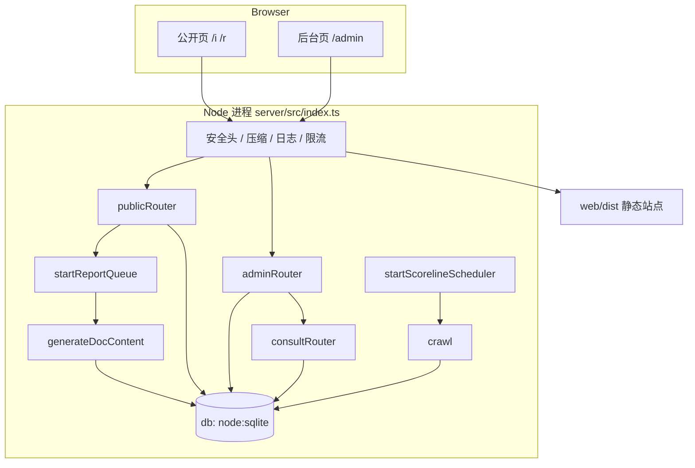
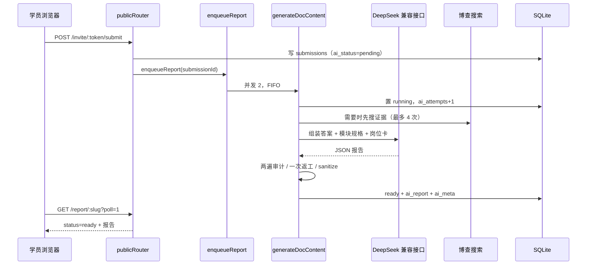
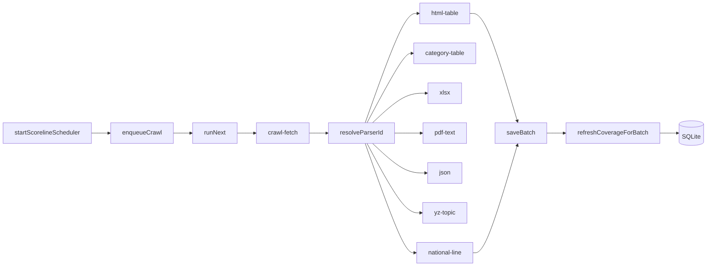

# 系统架构

## 1. 总体形状

一个 Node 进程、一个 SQLite 文件、一个前端静态目录。没有独立的消息队列、缓存服务或数据库服务。

图中的路由符号来自各自模块导出：`publicRouter`（`server/src/routes/public.ts`）、`adminRouter`（`server/src/routes/admin/index.ts`）、`consultRouter`（`server/src/routes/consult/index.ts`）；后台任务符号来自 `startReportQueue`（`server/src/ai/report-queue.ts`）、`generateDocContent`（`server/src/ai/doc-generate.ts`）、`startScorelineScheduler`（`server/src/score-lines/crawl-scheduler.ts`）。

## 2. 请求生命周期

1. **入口**：`server/src/index.ts` 装配 Express。顺序为：请求 ID 与访问日志 → 安全响应头 / CSP → gzip → JSON body → `/api/admin` → `/api` → `/api` 兜底 404 → 静态资源 → SPA 回退。
2. **公开路由**：`publicRouter` 处理 `/health`、`/invite/:token`、`/invite/:token/submit`、`/report/:slug`、`/report/:slug/retry`、`/report/:slug/claim`、`/events`。
3. **管理路由**：`adminRouter` 先挂 `/login` 与 `/dev-login`，随后 `adminRouter.use(requireAdmin())`，再挂 `/consult` 与各子路由。这个顺序意味着**任何新增管理接口只要挂在 `requireAdmin()` 之后，就自动带鉴权**；挂在之前则必须自己校验。
4. **错误处理**：`asyncRoute` 包装异步处理器，抛出后进入统一错误中间件；日志带 `reqId`。
5. **响应**：管理接口普遍调用 `noStore(res)`，避免浏览器缓存敏感数据。

## 3. 后端分层

| 层 | 位置 | 责任 | 不该做的事 |
| --- | --- | --- | --- |
| 装配层 | `server/src/index.ts` | 中间件、路由挂载、静态站点、启动任务 | 写业务规则 |
| 路由层 | `server/src/routes/**` | 参数校验、鉴权、事务边界、HTTP 状态码 | 直接拼报告文案 |
| 领域层 | `shared/src/**` | 问卷、评分、报告结构、日期/周期、分数线维度 | 访问数据库 / 读环境变量 |
| 持久层 | `server/src/db/**` | Schema、迁移、查询封装、会话、Skill | 处理 HTTP |
| 集成层 | `server/src/ai/**`、`server/src/score-lines/**` | 外部 API、抓取、解析、审计 | 决定产品文案口径 |
| 前端 | `web/src/**` | 页面、交互、API 客户端 | 复制后端评分规则 |

**共享层是纯函数**：`computeScores`、`buildReport`、`computeDocScores`、`validateAnswers` 都不读数据库、不读环境变量。这让报告可以在后台预览、公开页渲染、AI 审计三处复用同一套事实。

## 4. AI 报告流水线

关键参数与行为：

| 项 | 值 | 位置 |
| --- | --- | --- |
| 并发 | 2 | `server/src/ai/report-queue.ts#startReportQueue` |
| 最大尝试 | 4 | `server/src/ai/generate.ts` 的 `MAX_AI_ATTEMPTS` |
| 重试延迟 | 5s / 15s / 30s | `server/src/ai/generate.ts` |
| 启动恢复 | 恢复未超次数的 `pending` / `running` | `resumeUnfinishedReports` |
| 失败语义 | `doc` 模式不拿模板冒充成品；可重试失败给“重新生成” | `server/src/routes/public.ts` |
| 搜索 | 未配置 Bocha 则跳过；结果缓存 7 天，单飞 | `server/src/ai/bocha.ts` |

**为什么 AI 只写文案**：分数、优先级、截止时间、岗位卡由 `shared/src` 计算。AI 输出只填充叙事段落，并经 `doc-audit` 检查事实矛盾。这样模型波动不会改变“A/B/C 优先级”这类可解释结论。

## 5. 咨询稿子系统

四层结构（详见 `docs/reference/consult-system.md`）：

1. **目的层**：`shared/src/consult-purpose-data.json` 提供根 → 阶段 → 目的 → 蝴蝶节点。
2. **选择层**：`chooseConsultForestPath` 依据上下文与评分选路径；AI 不可用时有关键词回退。
3. **模块层**：`server/src/consult-modules.ts` 把目的拆成 10–20 个对话模块。
4. **节拍层**：每个模块生成 3 个策略/选项与若干节拍，落在 `consult_run_sections`。

运行状态：

- `POST /api/admin/consult/runs` 返回 `202`，后台任务 `startConsultJob` 执行。
- 生成中的 run 在内存集合 `activeConsultJobs` 里；进程重启后 `queued` / `running` 的 run 需要手动重试。
- 章节可编辑、可重生成、可增删；导出支持 `docx|html|txt`，由 `server/src/consult-export.ts` 渲染。

## 6. 分数线子系统

- **来源**：`seedScorelineSources` 写入 31 省专升本 + 研招网国家线/复试线汇总；`scoreline_sources.enabled` 可单独开关。
- **调度**：每 `SCORELINE_CRAWL_INTERVAL_MINUTES` 分钟检查一次；同一时间只允许一个 `queued|running` 抓取；按 `last_run_at` 最久优先选一个省。
- **分派**：`resolveParserId` 先看 `Content-Type`，PDF / Excel / JSON 不再被当 HTML；研招网来源的 PDF 强制走 `national-line`。
- **落库**：批次 + 指标 + 原始文档；自动写入默认 `approved` 的是导入接口，抓取结果按解析置信度进入待复核。
- **覆盖**：`school_coverage` 记录每校每年状态；复核通过会触发重算。
- **失败码**：`network|entry_redirect|no_table|unsupported_table|no_text_layer|parse|decode|needs_seed`，行首码供覆盖页给出下一步提示。
- **保留**：原始快照 90 天清理；结构化分数线不自动删。

## 7. 前端架构

- **路由级拆包**：入口 `Root.vue` 与 `NotFound.vue` 同步加载，其余页面懒加载（`web/src/router.ts`）。公开页不会把后台 chunk 打进首屏。
- **API 客户端**：`web/src/api/request.ts` 统一注入 Bearer Token、解析错误、处理 401；`admin.ts` / `public.ts` / `consult.ts` 按域拆分。
- **状态**：无 Vuex/Pinia。页面内 `ref` / `computed`，跨页状态靠路由参数与 `localStorage`（问卷草稿、Token）。
- **报告渲染**：`ReportBlocks.vue` 渲染结构化块；`html-to-image` 存图，`jspdf` 导出 PDF。
- **咨询工作台**：`ConsultWorkspace.vue` + `useConsultRuns` / `useConsultImport` 组合式函数，轮询运行状态。

## 8. 横切关注点

| 关注点 | 实现 | 位置 |
| --- | --- | --- |
| 日志 | 生产 JSON、开发可读行；`reqId` 串联；token/slug 脱敏 | `server/src/log.ts`、`server/src/index.ts` |
| 限流 | 内存计数：登录 10/5min、提交 8/min、报告 120/min、重试 5/min、领取 6/min、抓取 5/min | `server/src/util.ts#rateLimit` 与各路由 |
| 鉴权 | HMAC Token + `admin_sessions` 数据库会话；登出删会话 | `server/src/auth.ts#requireAdmin` |
| 安全头 | CSP、`X-Content-Type-Options`、`Referrer-Policy` 等 | `server/src/index.ts` |
| 保留期 | 事件启动时清理并每 24 小时再清；抓取快照仅启动时清理 | `pruneEventLogs`、`pruneCrawlDocuments` |
| 部署证明 | `data/deploy-info.json` 提供 commit / 版本 | `server/src/deploy-info.ts` |

## 9. 架构决策与代价

| 决策 | 理由 | 代价 / 边界 |
| --- | --- | --- |
| 单进程 + SQLite | 部署简单、事务一致、无需运维数据库 | 无法水平扩容；写并发受 SQLite 限制 |
| 进程内队列 | 零额外基础设施 | 重启丢失未开始任务；多实例会重复消费 |
| 确定性评分 + AI 文案 | 结论可解释、可审计 | 报告“个性”受模块规格约束 |
| 共享纯函数 | 三处渲染同一事实 | 修改需同时考虑公开页 / 预览 / 审计 |
| 文档优先 | 防止代码与规则漂移 | 每轮功能要写两遍（文档 + 代码） |
| 无测试框架 | 降低依赖与启动成本 | 路由/页面回归靠手工与用例脚本 |

## 10. 扩展点

| 想加什么 | 改哪里 | 必须同步 |
| --- | --- | --- |
| 新公开接口 | `server/src/routes/public.ts` | 前端 `web/src/api/public.ts`、05 契约、限流 |
| 新管理接口 | `server/src/routes/admin/` 下新建 router，在 `admin/index.ts` 的 `requireAdmin()` 之后挂载 | 前端 `admin.ts`、05 契约 |
| 新问卷题 | `shared/src/survey.ts` | `docs/reference/规划自测问卷-设计文档.md`（否则 `check:docs` 失败）、迁移兼容 |
| 新解析器 | `server/src/score-lines/parsers/` 实现 `Parser`，注册到 `parsers/index.ts` 的 `registry` | `resolveParserId` 的 Content-Type 分支、用例 |
| 新报告块 | `shared/src/doc.ts` 的 `DocAiContent` 与 `buildDocReportWithAi` | `web/src/components/ReportBlocks.vue`、审计规则 |
| 新咨询模板 | 后台“AI 分析规则”或 `server/src/db/skill.ts` | `check:audit` 用例、文档 |
