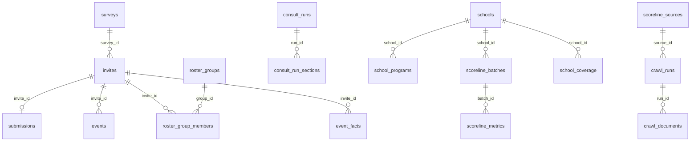

> 维护者：Doc Agent ｜ 最近更新：2026-11-18 ｜ 状态：草稿（定点勘误，待用户复核）

# 数据模型

## 1. 存储总览

| 项 | 结论 | 证据 |
| --- | --- | --- |
| 引擎 | SQLite，Node 内置 `node:sqlite` 的 `DatabaseSync` | `server/src/db/connection.ts` |
| 文件 | `DATA_DIR/vesta.db`，默认 `<ROOT>/data/vesta.db` | `server/src/env.ts#config` |
| 模式 | WAL、`synchronous=NORMAL`、`busy_timeout=5000` | `server/src/db/schema.ts#initSchema` |
| 表 | 36 张 | `server/src/db/schema.ts` |
| 索引 | 49 条 `CREATE INDEX` / `CREATE UNIQUE INDEX` | 同上 |
| 迁移 | 无迁移版本表；每次启动跑幂等 `ALTER` / 回填 | `server/src/db/migrations.ts#runMigrations` |
| JSON 存储 | 大量字段以 TEXT 存 JSON，读取时 `parseJson` 容错 | 各表 `answers/scores/context/...` |

单进程 + WAL 的边界：**同一时刻只有一个写者**。长事务会阻塞提交，因此代码里的事务都很短；批量删除按 5000 行分批（`pruneEvents`）。

## 2. 表目录

### 2.1 问卷、邀请、答卷

| 表 | 作用 | 关键列 / 约束 |
| --- | --- | --- |
| `surveys` | 问卷版本快照 | `id` PK、`version`、`data`（整份 Survey JSON）、`created_at` |
| `invites` | 一次性邀请 | `token` UNIQUE、`status`（`pending/opened/submitted`）、`survey_id`、`expires_at`、`opened_at`、`submitted_at`、`consulted`、`consult_result`、`priority` |
| `submissions` | 一次提交 | `slug` UNIQUE、`invite_id` UNIQUE、`report_mode`、`answers/scores/timing/overrides`、`ai_*`、`wechat_enc`、`slots` |
| `roster_groups` | 名单分组定义（软删除） | `id` PK、`name`、`created_at`、`deleted_at`、`is_default`；第一个分组自动成为默认组；默认组只在底层保留，界面不显示；`全部` / `默认分组` 是保留名，接口拒绝新建 |
| `roster_group_members` | 分组与邀请的多对多成员 | PK `(group_id, invite_id)`；索引 `idx_roster_group_members_invite` |
| `roster_hidden_dates` | 历史隐藏日期，**只留存量** | 代码不再读写（注释与 `migrations.ts` 说明） |
| `resume_images` | 已下线的简历图片，**只留存量** | 注释明确“确认清理前不要 DROP” |

归档不是表：邀请没有任何有效 `roster_group_members` 关系时，名单接口把它归入 `archive`；删组、移出最后一个有效组都会触发归档。默认组不参与界面展示，但仍是有效组：新邀请自动加入默认组，因此出现在“全部”且不会进入归档；归档学员通过“加入分组 → 全部”写回默认组。旧 `invites.group_id` 只保留历史归属，新分组不再读写它。

`submissions.ai_status` 状态机：`pending → running → ready | failed`；`ai_attempts` 最多 4；`ai_report` 存 AI 正文，`ai_meta` 存搜索元信息，`ai_started_at/ai_finished_at` 用于判超时与恢复。`report_mode` 在提交时固化，读取路径不再解析问卷 JSON。

### 2.2 事件与漏斗

| 表 | 作用 | 关键列 |
| --- | --- | --- |
| `events` | 原始埋点明细 | 自增 `id`、`invite_id`、`type`、`payload`、`created_at` |
| `event_facts` | 漏斗事实，长期保留 | PK `(invite_id, kind, key)`；`kind` 为 `start/group/exit`；`seq` 解决同毫秒排序 |

设计意图：`events` 可按保留期删除，后台漏斗仍能从 `event_facts` 读出稳定数字。

### 2.3 设置与会话

| 表 | 作用 | 关键列 |
| --- | --- | --- |
| `settings` | 键值配置 | `key` PK、`value` |
| `admin_sessions` | 登录会话 | `sid` PK、`username`、`expires_at` |

`settings` 中已知的键：

| key | 内容 | 写入方 |
| --- | --- | --- |
| `report_template` | 报告模板 JSON | `server/src/db/templates.ts#saveTemplate` |
| `report_skill` | 旧版单份 AI 规则 | `server/src/db/skill.ts` |
| `report_skill_templates_v1` | Skill 模板数组 JSON | `server/src/db/skill.ts` |
| `report_skill_active_v1` | 当前激活 Skill id | `server/src/db/skill.ts` |
| `admin_session` | 历史遗留键，登出时清理 | `server/src/db/sessions.ts` |

### 2.4 咨询

| 表 | 作用 | 关键列 / 约束 |
| --- | --- | --- |
| `consult_runs` | 一次咨询稿生成 | `id` PK、`template_id/name`、`mode`、`purpose_template_id`、`purpose_path`、`context/path/steps`、`status`、`outcome`、`target_length` |
| `consult_run_sections` | 章节 | PK `(run_id, seq)`；`title/goal/content/status/error`，迁移补 `options_json/beats_json/selected_option_id/notes/purpose_keys/edited` |
| `consult_purpose_feedback` | 目的节点反馈计数 | PK `(template_id, purpose_key)`；`selected/won/lost/liked` |
| `consult_collections` | 收藏栏 | `kind`、`title/content/url/source/summary`、`tags`（JSON）、`pinned` |
| `consult_quote_categories` | 金句栏分类 | `name` 唯一、`sort_order`、`created_at/updated_at` |
| `consult_quotes` | 金句栏金句 | `category_id`、`no`（原稿编号）、`text`、`source`、`pinned`、`sort_order` |
| `consult_story_categories` | 故事集分类 | `name` 唯一、`sort_order`、`created_at/updated_at` |
| `consult_stories` | 故事集故事 | `category_id`、`title`、`text`、`source`、`pinned`、`pinned_at`、`sort_order` |
| `consult_question_categories` | 有效的提问分类 | `name` 唯一、`sort_order`、`created_at/updated_at` |
| `consult_questions` | 有效的提问 | `category_id`、`text`、`note`、`pinned`、`pinned_at`、`sort_order`；索引 `(category_id, pinned DESC, pinned_at DESC, sort_order, created_at)` |
| `consult_topics` | 大学常识话题 | `title`、`body`、`sort_order`、`created_at/updated_at`；索引 `(sort_order, created_at, id)` |

`consult_runs.status` 与 `consult_run_sections.status` 使用同一组值：`queued | running | ready | failed`。`outcome` 为 `'' | won | lost | liked | abandoned`。

有效的提问与金句栏、故事集结构相似但独立成表：每道题只有一条 `note`（可为空），置顶时间写 `pinned_at`，分类存在性与非空删除限制在接口层校验；日志不记录正文与备注。

大学常识为扁平话题列表：`consult_topics` 不含分类与外键，`sort_order` 初始化为当前最大值 +1（新话题追加末尾），拖动排序时单事务整体重写；列表按 `sort_order`、`created_at`、`id` 稳定排序，正文只在单篇接口返回。日志不记录标题与正文。

### 2.5 外部检索缓存

| 表 | 作用 | 关键列 |
| --- | --- | --- |
| `search_cache` | 博查检索结果缓存 | `key` PK、`results` JSON、`created_at` |

缓存 7 天；错误结果不写缓存，避免把一次网络失败固化。

### 2.6 分数线 v3

| 表 | 作用 | 关键约束 |
| --- | --- | --- |
| `schools` | 全国院校主表 | UNIQUE `(name, province)`；`status`（`active/closed`） |
| `school_aliases` | 院校别名 | UNIQUE `alias` |
| `school_programs` | 招生计划 | UNIQUE `(school_id, year, exam, province, major_code, degree_type, study_mode)`；`review_status` |
| `scoreline_batches` | 分数线批次 | UNIQUE `(scope, exam, year, province, region, school_id, program_id, category, track)`；`review_status`、`checksum`、`confidence` |
| `scoreline_metrics` | 批次下的分数项 | UNIQUE `(batch_id, subject_code, is_minimum, minimum_type)` |
| `school_coverage` | 每校每年覆盖状态 | PK `(school_id, exam, year)`；`main_line/school_line/program_line/plan_count`、`last_run_id/last_error` |
| `scoreline_sources` | 抓取源 | `exam`、`province`、`parser_id`、`tier`、`interval_hours`、`enabled`、`last_run_at/last_status/last_error` |
| `crawl_runs` | 抓取任务 | `status`、`trigger`、`scope`、计数列、`message/details` |
| `crawl_documents` | 原始文档快照 | `url`、`http_status`、`content_type`、`storage_path`、`parser_id`、`parse_status`、`error` |

旧表 `score_line_sets` / `score_line_entries` 保留为 legacy，仅由 `migrateScoreLineV1` 读取；新代码不写。

**复核门禁**：查询只读 `review_status='approved'`；抓取默认 `pending`，导入默认 `approved`。这是“数字必须可追溯”的落点。

### 2.7 专业知识汇总

| 表 | 作用 | 关键列 / 约束 |
| --- | --- | --- |
| `knowledge_majors` | 知识库专业 | `id` PK、`name` UNIQUE、`sort_order`、`created_at/updated_at` |
| `knowledge_articles` | 专业下的知识点 | `id` PK、`major_id`、`title`、`body`、`sort_order`、`created_at/updated_at`；索引 `(major_id, sort_order, created_at)` |

两张表只由 `initSchema()` 幂等创建，**没有迁移、没有种子、没有 `settings` 标记**；不启用数据库外键，专业存在性与非空删除限制在接口层校验。知识点排序为 `sort_order` 升序、`created_at` 兜底；新增排在该专业末尾，换专业会排到新专业末尾。

### 2.8 关系图



> SQLite 未启用外键约束（Schema 中没有 `FOREIGN KEY` 声明）。上图的连线是业务关系，不是数据库强制约束。删除院校/答卷时需要在代码里自行保证一致性。

## 3. 关键字段与语义

### 3.1 `submissions`

| 字段 | 语义 | 注意 |
| --- | --- | --- |
| `answers` | 题目 id → 答案 JSON | 历史 key 与题号解耦，迁移做过回填 |
| `scores` | 分数/维度/明细 JSON | `doc` 模式 `total=0`、`tier` 为 A/B/C |
| `timing` | 题目 id → 毫秒 | 服务端截断到 15 分钟 |
| `overrides` | 诊断/结语覆盖 | 只接受 `diagnosis`、`closing` |
| `contact_status` | 跟进状态 | 默认 `new` |
| `wechat_enc` | 加密微信号 | 依赖 `CONTACT_KEY`；换 key 旧数据不可解 |
| `slots` | 可约时间 JSON 数组 | 1–3 个 |
| `ai_report` | AI 正文 | `doc` 模式为结构化 JSON 文本 |
| `ai_error` | 真实错误 | 学员侧只看到映射后的可执行提示 |

### 3.2 分数线维度

`scoreline_batches` 的 9 个维度共同构成唯一键：`scope`、`exam`、`year`、`province`、`region`、`school_id`、`program_id`、`category`、`track`。导入时若归一化后重复，接口会报“第 N 条与第 M 条是同一批次”，因为后写会覆盖前写。

`scope` 取值 `national | provincial | school | program`；`exam` 取值 `upgrade | postgrad`；`minimum_type` 取值 `'' | admit | retest | transfer | other`。

### 3.3 `invites` 咨询字段（v1.86 / v1.87）

| 字段 | 语义 | 注意 |
| --- | --- | --- |
| `consulted` | 是否已咨询，`0/1` | 取消咨询时服务端强制清空 `consult_result` |
| `consult_result` | `won / almost / maintaining / ''` | 旧脏值读取按未选择处理；标签为已成交 / 快成了 / 长期维护 |
| `priority` | 手工优先级，自由文本 | 写入前 `trim` 并截断到 20 字 |

## 4. 迁移

`runMigrations()` 在数据库首次导入时执行，设计为**可重复运行**：

| 函数 | 作用 |
| --- | --- |
| `ensureInviteColumns` | 补 `invites.group_id`（历史列） |
| `ensureSubmissionColumns` | 补 `report_mode`、`ai_*` 等列 |
| `backfillSubmissionReportModes` | 按历史问卷数据回填 `report_mode` |
| `ensureConsultColumns` | 补 `consult_runs.mode/purpose_*` 与章节扩展列 |
| `upgradeSurvey` | 按题号补/改题：Q18/Q21/Q25 多选、Q17 英语阶段、Q22 顺序、Q25 跳过、Q5a、Q27 薪资、Q28 自评 |
| `upgradeTemplate` | 模板结构升级 |
| `ensureScoreLineColumns` | 补来源/文档列 |
| `migrateScoreLineV1` | 从 legacy `score_line_*` 迁到 v3 |
| `seedConsultQuotes` | 首次写入 11 类 140 条金句；标记 `consult_quotes_seed_applied`，失败不写标记、下次启动重试 |
| `seed` | 首次写入默认问卷、模板、设置 |

故事集的两张表只由 `initSchema()` 幂等创建，**没有迁移、没有种子、没有 `settings` 标记**；分类存在性与非空删除限制在接口层校验（与金句栏一致，未启用数据库外键）。专业知识汇总的两张表同样无迁移、无种子，规则与故事集一致。

规则：

- 不建 `schema_migrations` 表，靠 `PRAGMA table_info` / 数据形状判断是否已迁移。
- **不要手写一次性迁移脚本**跑在生产库上；把逻辑放进 `migrations.ts` 并保证幂等。
- 改问卷题时，`check:docs` 会要求设计文档同步；改字段时，迁移必须兼容存量。

## 5. 保留、清理与增长

| 数据 | 保留 | 清理方式 |
| --- | --- | --- |
| `events` 业务事件 | `EVENT_RETENTION_DAYS`，默认 180 天 | 启动 + 每 24 小时，5000 行/批 |
| `events` 运维事件 | `EVENT_OPERATIONAL_RETENTION_DAYS`，默认 365 天 | 同上 |
| `event_facts` | 永久 | 不清理 |
| `crawl_documents` 原始快照 | 90 天 | 仅启动时：先删文件，再删行，最多 1000 行/次 |
| 结构化分数线 | 不自动删 | 人工维护 |
| `search_cache` | 读取时按 7 天判定过期 | 过期不命中；每次写入会顺带删除过期行 |
| `admin_sessions` | `SESSION_TTL`，默认 30 天 | 登录/校验时清理过期行 |

增长最快的通常是 `events`、`crawl_documents`、`consult_runs` 的正文。SQLite 删除不会自动缩小文件；不要在生产随手 `VACUUM`，它需要额外磁盘并持有写锁。

## 6. 备份与恢复

备份脚本：`deploy/backup.mjs`，使用 `VACUUM INTO` 生成一致性快照，不需要停服。

```bash
# cwd = 仓库根；<DB_NAME> 默认为 vesta.db
node deploy/backup.mjs data/<DB_NAME> data/backups/vesta-$(date +%Y%m%d-%H%M%S).db
```

- 预期：命令无输出，退出码 `0`；目标文件大小与源库同量级。
- 失败指向：源库不存在 → `SQLITE_CANTOPEN`；目标目录不存在 → 先建目录；磁盘满 → `SQLITE_FULL`。
- `update.sh` 在更新前自动备份到 `data/backups/`，并只保留最近 14 份（`ls -1t ... | tail -n +15 | xargs rm`）。

恢复步骤（需要人工确认，属于破坏性操作）：

1. 停服务。
2. 把备份文件复制为 `DATA_DIR/vesta.db`。
3. 删除同目录的 `-wal` / `-shm`（它们属于旧库）。
4. 启动服务，确认 `/api/health` 的 `db` 为 `true`。

## 7. 数据操作红线

| 操作 | 允许性 | 说明 |
| --- | --- | --- |
| 运行 `runMigrations` | 随启动自动 | 不要单独写脚本改生产库 |
| `DROP TABLE` | 禁止 | 包括 `resume_images`、legacy 分数线表；注释明确要求先确认 |
| 直接改 `submissions.answers` | 禁止 | 会与 `scores/tier` 不一致 |
| 直接改 `review_status` 为 `approved` | 谨慎 | 绕过复核会让无来源数字可被查询 |
| 删除 `DATA_DIR` | 禁止 | 会同时丢失数据库、抓取快照、部署信息 |
| `VACUUM` | 谨慎 | 需要停写与额外磁盘 |
| 导出学员联系方式 | 谨慎 | 属个人信息；导出后不得提交进仓库 |

## 8. 数据层待确认

| 项 | 现状 | 验证命令 |
| --- | --- | --- |
| `resume_images` 是否可清理 | 代码已不读写，注释要求确认后再删 | `grep -rn "resume_images" server/src web/src` |
| legacy 分数线表是否仍有数据 | 迁移后新代码不写 | `node -e` 查询 `score_line_sets` 行数（需本地库） |
| `not_offered` 是否有后台入口 | 覆盖状态支持，但后台是否可手动标记需确认 | `grep -rn "not_offered" server/src web/src` |
| 联系方式换 key 的迁移方案 | 当前无重加密工具 | `grep -rn "CONTACT_KEY" server/src` |
| `search_cache` 是否有清理任务 | 读取时判过期，写入时删除过期行，无独立定时任务 | `grep -rn "search_cache" server/src` |
