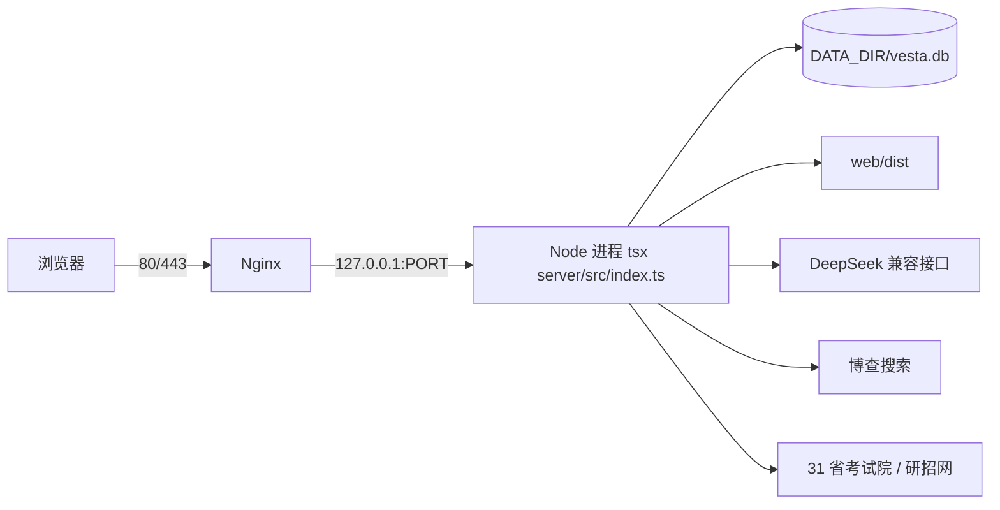

# 部署与运维

> `OPS` 家族有两篇：本篇是“怎么部署与日常运维”，[08-排障手册.md](./08-排障手册.md) 是“坏了怎么查”。

## 1. 部署拓扑



- Nginx 负责 TLS、域名、请求体上限与一层 gzip；Node 负责业务与静态站点。
- Node 是**单进程**；不要用 cluster 或多实例同时指向同一个 SQLite 文件。
- `PORT` 默认 `8787`；`docs/reference/README.md` 记载本机线上实例用 `8082`，由 systemd drop-in 覆盖。

## 2. 首次部署（systemd）

`deploy/install.sh` 是幂等安装脚本，要求 root：

```bash
# cwd = 仓库根；<USER> 默认为 www-data，APP_DIR 默认为 /opt/vesta
sudo APP_DIR=/opt/vesta RUN_USER=<USER> bash deploy/install.sh
```

- 前置检查：`APP_DIR/package.json` 存在、`APP_DIR/.env` 存在、`node` ≥24、`systemctl` 可用。
- 行为：建 `data/` 并 chown；把 `deploy/vesta.service` 的 `__APP_DIR__` / `__RUN_USER__` / `__NODE__` 替换后写到 `/etc/systemd/system/vesta.service`；`daemon-reload`、`enable`、`restart`；打印 `systemctl status`。
- 预期可 grep 的输出：`已安装。接下来配置 Nginx 和 HTTPS：`；退出码 `0`。
- 失败指向：提示缺 `.env` → 先 `cp .env.example .env` 并填 `ADMIN_USER/ADMIN_PASSWORD/AUTH_SECRET`；提示没有 node → 安装 Node 24。

安装脚本**不**配置 Nginx 与证书，需手工：

```bash
sudo cp deploy/nginx.conf /etc/nginx/sites-available/vesta.conf
# 修改 server_name 为 <DOMAIN>，再：
sudo ln -s /etc/nginx/sites-available/vesta.conf /etc/nginx/sites-enabled/
sudo nginx -t && sudo systemctl reload nginx
```

`deploy/nginx.conf` 的关键值：`client_max_body_size 25m`、`gzip on`、`proxy_read_timeout 60s`、转发 `X-Forwarded-For`。反向代理后必须在 `.env` 设 `TRUST_PROXY=true`，否则限流会把所有人算成一个 IP；直接对公网监听则保持 `false`。

> 注意：`deploy/nginx.conf` 的注释仍写着“简历上传允许 20MB”，但简历功能已下线。实际上限 25MB 仍服务于 DOCX 收藏导入（服务端上限 20MB）。

## 3. 日常更新：`update.sh` 的五层证明

目标不是“尽量做完”，而是**证明运行的代码 = `origin/main` 的最新 commit**。任一层失败立即退出，不带着旧代码或旧构建重启。

| 层 | 检查 | 失败行为 |
| --- | --- | --- |
| L1 代码 | 工作区干净、非 detached、分支为 `main`、`git pull --ff-only` 后 `HEAD == origin/main` | 不覆盖任何文件；打印差异与手动处理建议 |
| L2 依赖 | `package-lock.json` 变化或 `node_modules` 缺失时 `npm ci --include=dev`；`npm ls --depth=0` 无 `missing/invalid/unmet` | 修复失败则退出，不重启 |
| 备份 | `data/vesta.db` 存在时 `VACUUM INTO` 到 `data/backups/`，保留最近 14 份 | 备份失败则不构建、不重启 |
| L3 构建 | 先移走旧 `web/dist`；`npm run build`；检查 `index.html`、`assets/`、产物时间晚于构建开始 | 失败自动恢复上一版 dist，不重启 |
| L4 进程 | 写 `data/deploy-info.json`；按模式重启；30 秒内确认进程/容器启动时间晚于构建完成 | 打印最近日志与恢复提示 |
| L5 对外 | `/api/health` 返回 200 且 `ok:true`、`time` 不早于重启、版本与 HEAD 一致；首页引用本次构建的 JS 指纹 | 30 秒内不通过则失败，打印 health 输出 |

用法：

```bash
# cwd = 仓库根
bash update.sh                 # 拉取 + 校验 + 备份 + 构建 + 重启 + 验收
bash update.sh --no-pull       # 不 pull，但仍要求 HEAD == origin/main
bash update.sh --skip-build    # 仅当 dist 不旧于源码时允许
bash update.sh --mode=systemd  # docker / systemd / pm2 / none / auto
```

- 预期可 grep 的输出：`更新完成：运行的代码已校验为 origin/main 的`；退出码 `0`。
- 失败指向：输出末尾有“失败阶段 / 查看日志 / 数据库备份 / 回滚代码 / 重启服务”五段恢复信息。
- `DEPLOY_MODE=none` **一定在 L4 失败**：不自动重启就无法证明运行的是新代码。
- 并发保护：`flock data/update.lock`（无 flock 时用目录锁），同一目录只允许一个更新。
- 自更新：拉取后若 `update.sh` 变化，脚本会用新脚本带 `--resumed` 重新执行，避免旧逻辑跑完后半段。
- 更新前请先 `git stash push -u` 或提交；脚本拒绝脏工作区。

## 4. 运行模式

| 模式 | 识别方式 | 重启命令 | 进程启动时间来源 |
| --- | --- | --- | --- |
| `systemd` | `vesta.service` 存在 | `systemctl restart vesta` | `ExecMainStartTimestampMonotonic` |
| `pm2` | `pm2 pid vesta` 有值 | `pm2 restart vesta --update-env` | `pm2 jlist` 的 `pm_uptime` |
| `docker` | `compose` 文件 + 运行中的 vesta 容器 | `docker compose up -d --build` | `docker inspect .State.StartedAt` |
| `none` | 手工指定 | 不重启 | 无法验证，L4 直接失败 |
| `auto` | 依次探测 docker → systemd → pm2 | 对应模式 | 对应模式 |

`systemd` 单元（`deploy/vesta.service`）要点：

- `EnvironmentFile=__APP_DIR__/.env`，`Environment=NODE_ENV=production`。
- `ExecStart=__NODE__ __APP_DIR__/node_modules/tsx/dist/cli.mjs __APP_DIR__/server/src/index.ts`；没有 `npm start` 中间层。
- `Restart=always`、`RestartSec=3`。
- `ReadWritePaths=__APP_DIR__/data`。该指令只有在配合 `ProtectSystem` / `ReadOnlyPaths` 时才真正收紧写权限；当前单元未设置这些指令，不要把它当成完整的文件系统沙箱。

## 5. 健康检查与监控

| 检查 | 命令 | 通过标准 |
| --- | --- | --- |
| 进程 | `systemctl status vesta --no-pager` | `active (running)`，启动时间与本次部署一致 |
| 健康 | `curl -fsS http://127.0.0.1:<PORT>/api/health` | `ok:true`、`db:true`、`commit` 等于期望短哈希 |
| 首页指纹 | `curl -fsS http://127.0.0.1:<PORT>/ \| grep assets/` | 引用 `web/dist` 当前入口 |
| 日志 | `journalctl -u vesta -n 100 --no-pager` | 无持续 `error`；启动有 `server.started` |
| 数据库 | 健康接口 `db:true` | `SELECT 1` 成功 |
| AI | 后台“AI 分析规则”页的 `ai.configured` | 配了 key 应为 `true` |
| 抓取 | `GET /api/admin/score-lines/crawl/queue` | 无长期卡在 `running` 的任务 |

日志字段：生产为 JSON `{ts, level, msg, reqId?, ...}`；开发为可读行。`reqId` 可把一次请求的多条日志串起来。日志中 token、报告 slug 会被替换为占位，不要试图从日志里找原始链接。

## 6. 备份与恢复

- 自动：`update.sh` 每次更新前备份，保留 14 份。
- 手工：

```bash
# cwd = 仓库根
node deploy/backup.mjs data/vesta.db data/backups/vesta-manual.db
```

- 预期：无输出，退出码 `0`，目标文件可被 SQLite 打开。
- 失败指向：`SQLITE_CANTOPEN` 源库路径错；`SQLITE_FULL` 磁盘满；目标目录不存在先 `mkdir -p`。

恢复是破坏性操作，必须人工确认：

1. `systemctl stop vesta`（或对应模式停服）。
2. `cp data/backups/<备份文件> data/vesta.db`。
3. 删除 `data/vesta.db-wal`、`data/vesta.db-shm`。
4. 启动并检查 `/api/health` 的 `db`。
5. 抽查最近一份答卷与报告状态。

## 7. 配置与密钥运维

| 动作 | 影响 | 注意 |
| --- | --- | --- |
| 改 `AUTH_SECRET` | 所有已发 Token 失效，管理员需重新登录 | 不会影响答卷与报告 |
| 改 `CONTACT_KEY` | **旧 `wechat_enc` 永久不可解** | 目前没有重加密工具；换前先导出或确认可放弃 |
| 改 `ADMIN_PASSWORD` | 下次登录用新密码 | 已登录会话仍有效，直到过期或登出 |
| 改 `AI_API_KEY` / `AI_BASE_URL` | 新报告生效；队列中任务重试时用新配置 | 改错会让报告进入 `failed` |
| 关闭抓取 `SCORELINE_CRAWL=off` | 不再自动入队；手动抓取仍可用 | 重启生效 |
| 开 `TRUST_PROXY=true` | 限流按 `X-Forwarded-For` 取 IP | 只有确实在可信反代后才开 |

密钥只放 `.env` 或部署平台 secret；不要写进仓库、日志、截图、Issue。

## 8. 容量与性能

| 资源 | 现状 | 观察点 |
| --- | --- | --- |
| CPU | 单进程；构建与抓取是峰值 | 更新时构建会占 CPU；抓取一次一个省 |
| 内存 | 报告队列并发 2；咨询生成另有内存任务 | AI 大响应 + 并发会抬内存 |
| 磁盘 | SQLite + 90 天抓取快照 + 14 份备份 | 快照目录 `DATA_DIR/crawl` 增长最快 |
| 写锁 | SQLite 单写者 | 长事务、批量删除会阻塞；清理已分批 |
| 外部依赖 | AI / 搜索 / 31 省站点 | 超时与失败码见 [08](./08-排障手册.md) |

不建议在同一 `DATA_DIR` 上跑两个 Node 实例：报告队列、抓取队列、限流计数都是进程内状态，会重复消费或互相踩踏。

## 9. 运维 Runbook

| 场景 | 动作 | 验收 |
| --- | --- | --- |
| 发版 | `bash update.sh` | 五层全过，输出“更新完成” |
| 只重启 | `sudo systemctl restart vesta` | `systemctl status` active；health `ok` |
| 回滚代码 | 按 `update.sh` 恢复提示：`git reset --hard <旧 commit> && npm ci --include=dev && npm run build`，再重启 | health `commit` 等于旧 commit；首页指纹变化 |
| 回滚数据 | 停服 → 覆盖 `vesta.db` → 删 `-wal/-shm` → 启动 | 抽查答卷/报告 |
| 关闭抓取 | `.env` 设 `SCORELINE_CRAWL=off` 并重启 | 队列不再新增 `trigger=schedule` |
| 清抓取积压 | `DELETE /api/admin/score-lines/crawl/queue/:id` 取消未开始任务 | 队列只剩 `running` 或空 |
| 证书续期 | 由 certbot 负责；检查 `nginx -t` | HTTPS 200，证书未过期 |
| 磁盘告警 | 清旧备份（保留 ≥1 份）、清 90 天外快照、评估 `VACUUM` | `df -h` 回落；health 正常 |

## 10. 部署侧待确认

| 项 | 现状 | 验证 |
| --- | --- | --- |
| 线上真实端口 `8082` | 文档记载由 systemd drop-in 覆盖 | 在生产执行 `systemctl cat vesta` 看 `zz-port.conf` |
| docker 模式是否有 compose 文件 | 仓库根未看到 `docker-compose.yml` / `compose.yaml` | `ls docker-compose.yml compose.yaml` |
| `ReadWritePaths` 是否生效 | 缺 `ProtectSystem` 等指令，可能不构成写限制 | `systemd-analyze security vesta` |
| 备份是否异地 | 仓库只提供本地 `data/backups` | 检查是否有外部备份任务；无则登记风险 |
| 更新回滚演练 | 脚本给出命令，但未自动回滚 | 在预发环境走一次 `git reset` 流程 |
